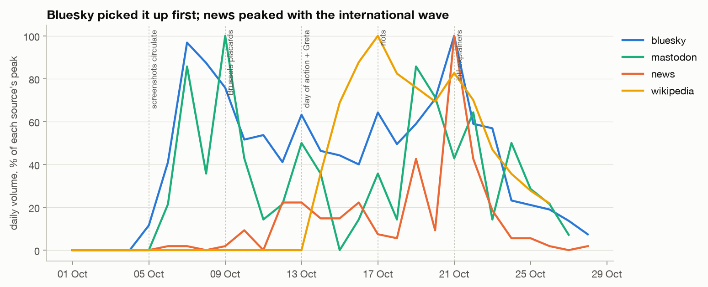
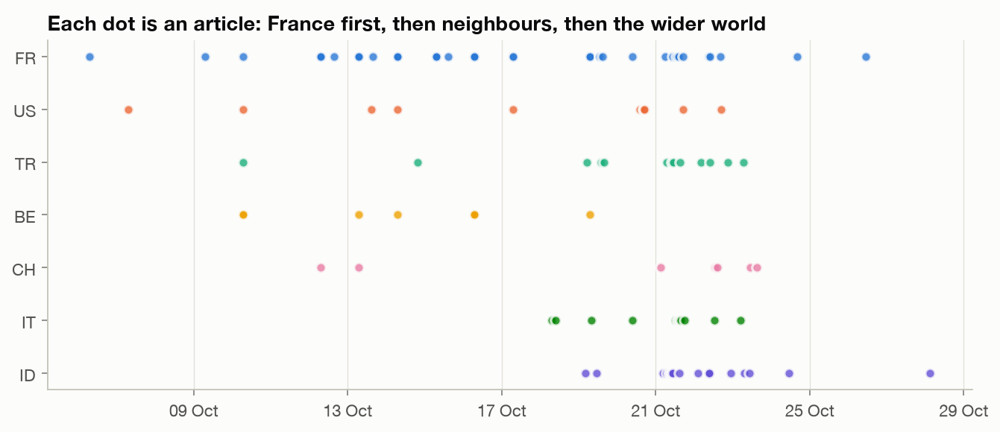
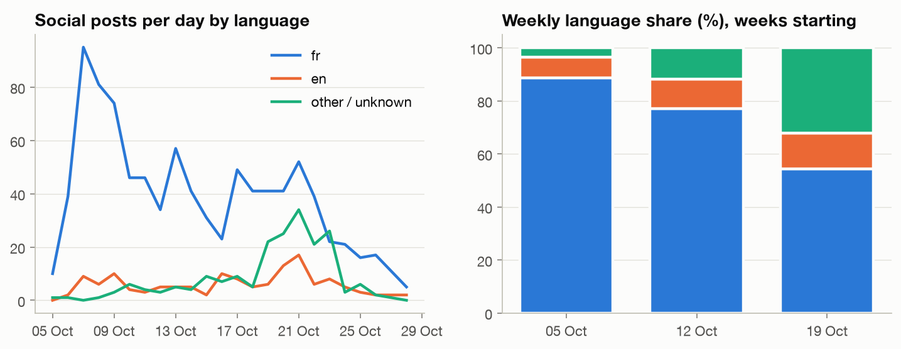
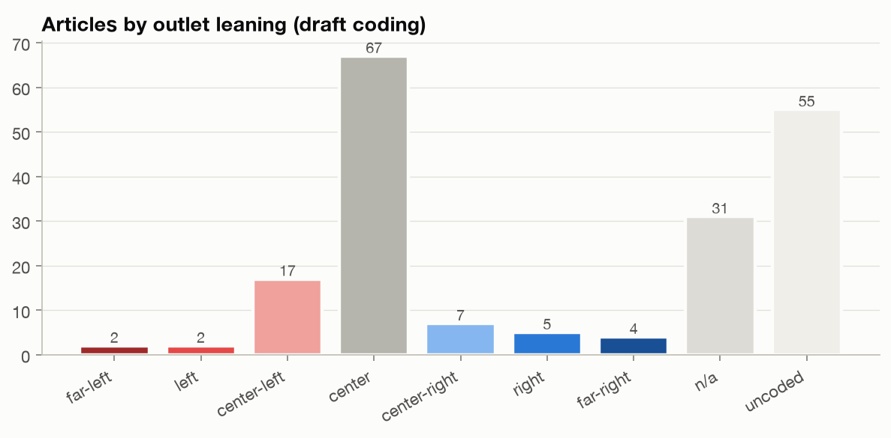
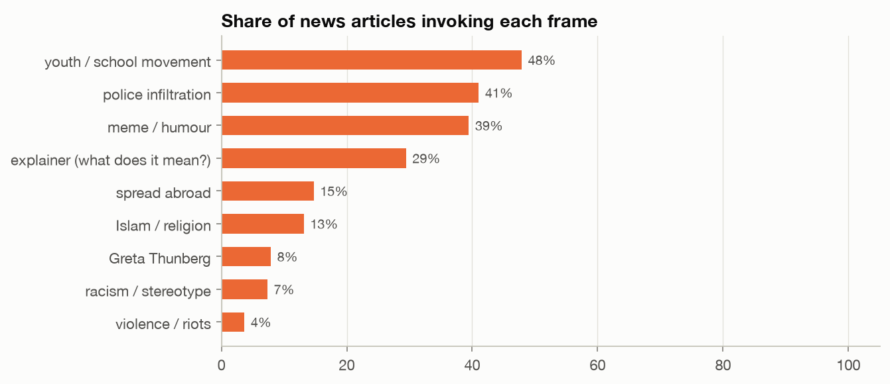
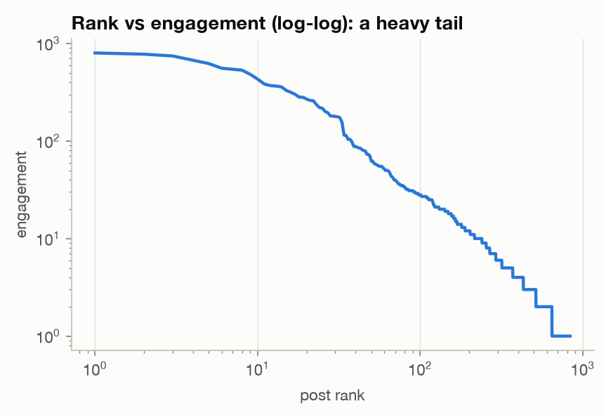

# Initial EDA: « Bismillah c'est les ténèbres »

*First pass, data collected 26 Oct 2026 and extended 28 Oct 2026. Notebook: [`notebooks/01_initial_eda.ipynb`](../notebooks/01_initial_eda.ipynb). Methods and caveats: [`docs/methodology.md`](../docs/methodology.md).*

> **Status:** news comes from Google News (190 on-topic articles from 35 countries, found with French queries plus English and Arabic translations of the slogan across 23 editions). **GDELT and Reddit are not in yet**: both are throttling our IP, and both collectors now resume across runs. GDELT also turned out to search English *machine translations*, so our French-keyword queries found only 11 English articles; an English query has been added. Social data covers Bluesky (1,136 posts), Mastodon (120) and Lemmy (12), but not the origin platforms (Snapchat, TikTok, Instagram, X). Outlet leaning codes are a draft. Treat everything below as hypotheses to test.

## Data at a glance

| Source | Rows | Window |
|---|---|---|
| News articles (Google News, 23 editions) | 203 collected, **190 on topic**; 186 with full text, 158 of those contain the slogan (French or translated) | 6–28 Oct |
| Bluesky posts | 1,136 (+ 3,699 repost/quote edges for the top 40 posts) | 5–28 Oct |
| Mastodon posts (hashtag timelines) | 120 | 6–27 Oct |
| Lemmy posts and comments | 12 | 9–25 Oct |
| Wikipedia | 5 language editions, 273 revisions, daily pageviews | 14–27 Oct |

**What changed on 28 Oct:** the window now runs to 28 Oct, and coverage is wider in three ways:
- **News:** 10 more Google News editions (Arabic, Indonesian, Portuguese, Dutch, Bengali, Pakistani English) and translated queries.
- **Slogan matching:** the matcher now also recognises the English and Arabic renderings of the slogan.
- **Off-topic filter:** news items that never mention the slogan (13 of 203) are flagged and excluded.

## 1. Where it started: social media first, news a day later

- **Earliest observable use: Bluesky, 5 Oct 07:21 UTC**, as a parody of an imagined police officer's voice. By that evening a post linking it to police infiltration of lycéen Snapchat groups had become one of the most-engaged posts in the dataset.
- **First news article: 6 Oct (*Nice-Matin*)**, an explainer on lycéen in-jokes. **The next day, 7 Oct, a US outlet already mentioned it**: NTD (Epoch Media group, right-leaning) reported a placard reading "Bismillah, it's darkness" at a Paris blockade. It listed the placard alongside "To arms!" and "Sexy antifa girl" signs. This was found only because the matcher now recognises the English translation, and it moves the first non-French coverage from mid-October to 7 Oct.
- Coverage stayed sparse until **12–13 Oct**, when a burst of French explainers appeared (20 Minutes, regional EBRA titles, franceinfo, France 24).
- **Three attention phases:**
  1. *In-group meme* (5–10 Oct): Bluesky's first peak on 7 Oct (92 posts), before the press notices.
  2. *Domestic explainer wave* (12–17 Oct): news, the Greta Thunberg moment (13 Oct), Wikipedia articles (14 Oct). French Wikipedia pageviews peak at about 33k/day on 17 Oct, the day of the riots.
  3. *International wave* (19–22 Oct): news peaks on **21 Oct** (54 articles), the same day as Bluesky's overall high (95 posts). English Wikipedia peaks on 19 Oct (3.6k/day).

## 2. How it travelled across countries and languages

- **France → francophone media → Turkey and English-language media → Italy → Indonesia and the wider Muslim world.**
  - **Francophone neighbours:** Belgium (La DH, 10 Oct) and Switzerland (Watson, 12 Oct) followed quickly.
  - **Turkey:** the state agency Anadolu covered it on 10 Oct in its French-language service, and Turkish-language outlets followed from 14 Oct.
  - **English-language media:** after NTD's early mention, sustained coverage began on 14–16 Oct (Frenchly, Newsfire, Middle East Eye), and the NYT published on 20 Oct.
  - **Italy:** coverage started on 18 Oct, right after the slogan was chanted in Bologna and Milan.
- **Indonesia is now the second-largest country in the sample (25 articles, from 19 Oct)**, ahead of Turkey (13) and Italy (12). Arabic coverage (Saudi, Qatari, Egyptian, Palestinian, Moroccan, Jordanian outlets) and Bangladeshi Bengali coverage arrived on 18–23 Oct. Combined with the Persian and Indonesian Wikipedia articles, this points to substantial uptake in Muslim-majority media, where the "Bismillah" half of the phrase is the hook.
- **Outlets translate the slogan in different ways**, which affects any keyword-based tracking:
  - English: *"In the name of God, it's the darkness"*.
  - Arabic: *"بسم الله، إنه الظلام"* or *"إنها الظلمات"*.
  - German: *"Im Namen Gottes, es ist die Finsternis"*.
  - Spanish: *"son las tinieblas"*.
  - Portuguese: *"são as trevas"*.
  - Indonesian: *"Bismillah Gelap"* or *"Inilah Kegelapan"*.
  - Turkish: *"ortalık felaket"*.
- **69% of articles are from non-French outlets.** The slogan became an international curiosity: "what does this mean?" explainers dominate abroad.
- **Social conversation internationalised too.** The share of French-language posts fell from 89% (week of 5 Oct) to 77% (week of 12 Oct) and 54% (week of 19 Oct).

- **Wikipedia documented it in an unusual set of languages**: English and French (14 Oct, created 15 minutes apart), then **Basque, Persian and Indonesian** (19–21 Oct).

## 3. Coverage across the political spectrum

- **French coverage is dominated by centrist and regional outlets** (39 of 59 French articles), mostly syndicated explainers. Partisan outlets covered it much less:
  - **Left bloc, 6:** NPA, Libération, Le Monde, HuffPost.
  - **Right, 4:** Le Figaro, Le Point.
  - **Far-right, 4:** Valeurs actuelles, JDD, Boulevard Voltaire, Reinformation.tv.
- **Framing differs by bloc** (keyword-dictionary pass on headline + slogan context; all countries; small n, so directional only):

| frame (% of articles) | left bloc (n=21) | centre (n=67) | right bloc (n=16) |
|---|---|---|---|
| explainer "what does it mean?" | 24 | **51** | 25 |
| police infiltration | 24 | **54** | 38 |
| racism / stereotype | 5 | 4 | 0 |
| Islam / religion | 5 | 13 | **19** |
| violence / riots | 10 | 0 | **12** |
| spread abroad | **24** | 12 | 0 |

  - **Right-leaning outlets** frame the slogan through **Islam and violence** and never mention the racism critique.
  - **Left outlets** emphasise **international spread**. On the wider sample the racism frame is rare everywhere (4–5%) and no longer distinguishes left from centre, as it seemed to on 26 Oct.
  - **Centrist outlets** mostly *explain* it, through the police-infiltration origin story.
  - This is the most promising thread for the framing analysis, but it needs GDELT's wider outlet coverage and proper hand-coding.
- **Sentiment of the slogan's context paragraph** (slogan masked) is negative everywhere, most of all in right-bloc outlets (−0.62, n=12, vs −0.29 centre). This is consistent with the framing difference, but the sample is tiny.
- **Meaning drift:** by 21–22 Oct the phrase was being used *about* politicians. Matthieu Pigasse applied it to Raphaël Glucksmann ahead of the 2027 presidential race (Libération, Le Parisien, Closer). The slogan moved from protest meme to general political insult in about two weeks.

## 4. Social propagation

- **Attention is extremely concentrated.** On Bluesky the top 1% of posts hold 34% of all engagement and the top 10% hold 81%. The median post got 2 interactions, and 27% got none. The top 20 accounts account for 60% of engagement.
- **The early amplifiers were left-leaning French accounts and public academics** (a linguist doing live "placard analysis", a historian), not news organisations. The *New York Times* account is the only institutional account in the top 20 (20 Oct).
- **Cascades:** 1,952 distinct accounts reposted at least one of the 40 most-shared posts, and **33% of them reposted more than one**, which points to a core amplifier community. Quote posts arrived a median of 8 hours after the original (90th percentile: 42 hours), so posts kept travelling for about two days.
- **Links shared alongside the slogan:** GIFs and YouTube parodies dominate, followed by Swiss outlet heidi.news, the NYT, France 24, Middle East Eye, Euronews, franceinfo and Libération. So social media amplified **centre and centre-left coverage**; no right-leaning outlet appears among the most-linked domains.
- **Lemmy** adds 12 posts and comments: a francophone instance (jlai.lu) plus English-language news, meme and left-wing communities. That's too few to analyse alone, but it confirms the English meme framing ("In the name of Allah, it is the darknesses").

### What people say alongside the slogan (BERTopic, 972 posts with the slogan masked, exact duplicates dropped)

| topic (keywords) | posts | trend (weeks of 5, 12, 19 Oct) |
|---|---|---|
| **Parody of the "infiltrator voice"** (wesh, brigands, binz…) | 226 | 114 → 64 → 45: dominant early, then fades |
| **International/English coverage sharing** (france, french, slogan, student) | 148 | 11 → 33 → 98: rises with the international wave |
| Wordplay and riffs on the phrase | 88 | 34 → 25 → 24 |
| **Speculation about the police author** (flic, policier, DNRT) | 62 | stable |
| Lycéen / youth culture (jeunes, lycéens) | 55 | peaks week of 12 Oct |
| Snapchat infiltration and racism | 45 | 16 → 19 → 10 |
| Smaller topics: links and videos, youth language, left/right politics, joy and laughter | 12–41 each | |

The topic trends support the three-phase story: **parody → movement slogan → international news object**. Topic results vary with the random seed; see the methodology.

### Sentiment and toxicity: one important methods note

The slogan itself skews the models. On its own it scores 88% "positive" and 20% "toxic", and the toxicity comes from *"c'est les ténèbres"*, not from *"Bismillah"*. Scoring raw posts would make the conversation look positive (+0.19 on Bluesky). With the slogan masked, the surrounding text is mildly negative (**−0.17 Bluesky, −0.13 Mastodon**; Lemmy −0.29 but n=12). That fits a conversation that mocks the police. Toxicity of the surrounding text is low (Bluesky median P(toxic) = 0.01). Both still need validation on a hand-coded sample.

## 5. Open questions for the next round

1. **Fill the news gap with GDELT.** The collector now resumes across runs and has an English query (`bismillah darkness`) that reaches machine-translated coverage. Re-run it until it finishes, ideally from another network. Then redo the country and leaning analysis on a much larger, less Google-curated sample, and add GDELT tone.
2. **Reddit** (r/france, r/rance, r/moi_dlvv, r/europe…): does the French Reddit "meme" culture match Bluesky's, or skew differently? Arctic Shift now only allows full-text search within a subreddit, so the collector sweeps a list and discovers more subreddits through posts that link our news articles.
3. **The origin platforms.** Apply for the TikTok Research API / Meta Content Library, or hand-collect seed posts, to trace the 1–5 Oct jump from Snapchat to TikTok/Instagram/X.
4. **Validate outlet leanings** with a documented source and a second coder, and code the 55 on-topic articles from outlets that have a country but no leaning yet, mostly Indonesian, Arabic, Turkish and Bengali media, where a left–right scale may not fit.
5. **Build a framing codebook** from the dictionary pass, and hand-code all ~190 articles with two coders. The dictionaries are French/English-centric and miss the Indonesian, Arabic and Turkish coverage.
6. **Far-right and Muslim-world uptake:** how did far-right outlets and accounts use the phrase after the 17 Oct riots? Was it inverted ("bismillah" as an Islam signifier)? How did Indonesian, Arabic, Turkish and Bangladeshi media frame it? Was it treated as Muslim solidarity, a curiosity, or a misuse of a religious formula?
7. **Meaning drift over time:** extend the topic model with `topics_over_time`, and add a usage typology (mocking police / protest chant / explainer / political insult).
8. **Re-collect weekly** while the story is live, archiving snapshots so deleted posts and changes in search rankings are captured.
